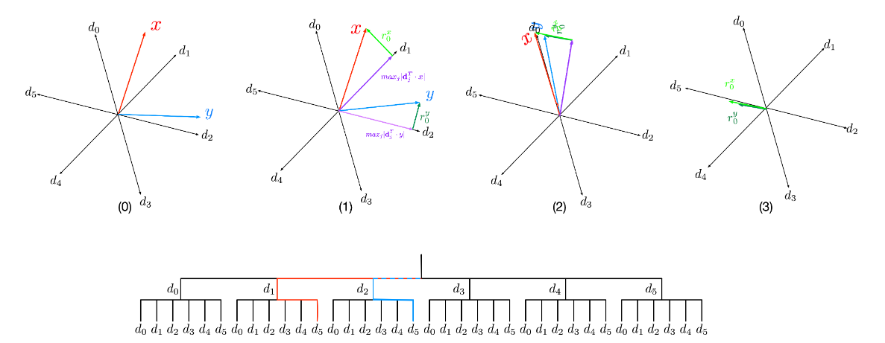

# Décomposition itérative de x-vecteurs par Rotated Matching Pursuit Sparse Autoencoder (RMP-SAE)

## 1. Contexte et Objectif

Les x-vecteurs sont des plongements (embeddings) profonds très performants pour la reconnaissance du locuteur. Cependant, leur espace latent d-dimensionnel est fortement intriqué : un même axe mélange des informations relatives au timbre, au sexe, à la prosodie ou au canal d'enregistrement.

L'objectif est d'implémenter un Rotated Matching Pursuit Sparse Autoencoder (RMP-SAE). Contrairement aux auto-encodeurs classiques qui projettent l'entrée en une seule passe, le RMP-SAE décompose le x-vecteur de manière itérative.

## 2. Installation

### Cloner le dépôt git :

git clone https://github.com/Nathan-Perron/DL-RMP_SAE.git

### Création de l'environnement Conda :

- conda create --name nomEnvironnement
- conda activate nomEnvironnement
- conda install ipykernel
python -m ipykernel install --user --name nomEnvironnement --display-name "Python (nomEnvironnement)"
- conda install scikit-learn
- conda install numpy
- conda install torch
- conda install tqdm

### Utilisation :

Lancement du notebook présent à la racine du projet qui utilise les différents modules présents dans le dossier "modules" (fichier .py).

## Membres du groupe

| Nom | Contact |
| :--- | :--- |
| **Bossard Guilian** | Guilian.Bossard.Etu@univ-lemans.fr |
| **Perron Nathan** | Nathan.Perron.Etu@univ-lemans.fr |
